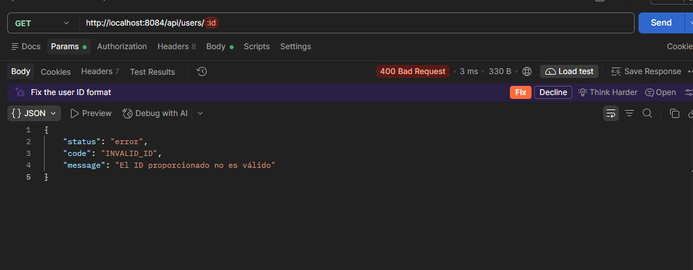

# ShipNow API

API de ShipNow con arquitectura por capas (Controller → Service → Repository), hecha con Node.js, Express y MongoDB (Mongoose).

## Instalar e Iniciar localmente la API
1. Clonamos el repositorio, desde la página, para luego abrir una terminal en la carpeta donde quede el archivo.
2. Lo instalamos, lo hacemos con las siguiente línea:
```bash
npm install
```
3. Una vez que ya esté todo instalado, copiamos el archivo `.env.example` a `.env` y lo completamos con las variables solicitadas. La lista completa, con valores válidos y un ejemplo, está en la sección [Variables de entorno](#variables-de-entorno).

4. Una vez que el `.env` esté completo nos podremos poner a iniciar el servidor, usando la siguiente línea:
```bash
npm run dev
```
O
```bash
npm start
```
- Si hay algún fallo de la API a la hora de iniciar se debe corroborar que todos las variables estén completas y sean auténticas y utilizables.

Necesita un MongoDB en `mongodb://localhost:27017` la cual se ingresa en el `.env`.

## Variables de entorno

La configuración se lee de un archivo `.env` (para desarrollo y producción) o `.env.test` (para los tests). Las dos plantillas, `.env.example` y `.env.test.example`, están en el repositorio. La API valida todo al arrancar: si falta una variable obligatoria o tiene un valor inválido, **no inicia** y muestra todos los errores juntos.

| Variable | Descripción | Valores válidos | Por defecto | Obligatoria |
|---|---|---|---|---|
| `PORT` | Puerto en el que escucha el servidor | Entero entre 1 y 65535 | — | Sí |
| `MONGODB_URI` | URI de conexión a MongoDB (local o Atlas) | Una URI `mongodb://` o `mongodb+srv://` | — | Sí |
| `NODE_ENV` | Entorno de ejecución | `development`, `test`, `production` | — | Sí |
| `UPLOADS_DIR` | Carpeta donde se guardan documentos y comprobantes | Una ruta | `uploads` | No |
| `LOG_LEVEL` | Nivel mínimo de logs en consola | `fatal`, `error`, `warning`, `info`, `http`, `debug` | `info` en `production`, `debug` en el resto | No |
| `ENABLE_SWAGGER` | Publica la documentación en `/api/docs` | `true`, `false` | `true` | No |

### Ejemplo de `.env`
```env
PORT=3000
MONGODB_URI=mongodb://localhost:27017/shipnow
NODE_ENV=development
UPLOADS_DIR=uploads
LOG_LEVEL=debug
ENABLE_SWAGGER=true
```

### Qué no se usa
Esta API no tiene autenticación ni consume servicios externos, por eso **no hay** variable para una clave JWT ni para URLs de terceros.

## Tecnologias en uso

- Node
- Express
- Faker-js
- Dotenv
- Mongoose
- MongoDB
- Winston
- winston-daily-rotate-file
- swagger-jsdoc
- swagger-ui-express
- Mocha
- Chai
- Supertest
- Multer

## Estructura de la API

```
src/
├── config/           # carpeta donde se guardan las configuraciones de la conexión a la DB y las variables de entorno validadas
├── constants/        # aquí se guardan esas constantes que pueden ser usadas en toda la API, roles de usuarios o estados de productos
├── controllers/      # manejo de las req y las res
├── middlewares/      # manejo de errores de forma centralizada
├── models/           # los modelos de mongoose, acá no se recibe ni debe escribirse lógica del negocio
├── repositories/     # conecta la base de datos con el sistema, es el único que debe conectarse entre ambos
├── routes/           # conectan cada endpoint con su controlador
├── errors/           # errores personalizados (AppError) y diccionario de errores
├── docs/             # documentación Swagger/OpenAPI: un .yaml por módulo y schemas
├── utils/            # funciones de apoyo (armar los metadatos de un archivo y borrarlos)
└── services/         # se encarga de contener toda la lógica del negocio

tests/                # tests funcionales (Mocha, Chai y Supertest), fuera de src/
uploads/              # archivos cargados: documents/ y receipts (esta carpeta y sus subcarpetas no se suben al repositorio ya que son locales para cada usuario)

```

## Logging y monitoreo

### Herramienta utilizada
Para el registro de eventos se utiliza **Winston**, el cual se encarga de registrar los eventos, en conjunto con **winston-daily-rotate-file** que realiza el trabajo de guardar en archivo los errores que se generan en nuestra API, organizandolo por fecha de creacion. Toda la configuracion de esta herramienta se centralizó en `src/config/logger.js` para no necesitar reescribir el mismo codigo y directamente importar el sistema a donde necesitemos. 

Lo que busca esto es reemplazar los `console.log` sueltos permitiendo clasificar por nivel de importancia y darles un formato común (fecha, nivel y mensaje), centralizando el tipo y la manera que tiene para guardar logs nuestra API, guardando estos en archivo con fecha y hora exacta del mismo para proceder a su posterior consulta. Lo que propone el logger es complementar el manejo de errores, sin modificar las respuestas a los clientes, y registrar los errores internos para poder ser solucionados.

### Niveles de log

| Nivel | Prioridad | Para qué se usa en ShipNow |
|---|---|---|
| `fatal` | 0 | Fallas críticas, por ejemplo no poder conectar con MongoDB al iniciar |
| `error` | 1 | Errores inesperados del servidor, con su stack |
| `warning` | 2 | Errores esperados o del cliente: ID inválido, ruta inexistente, cantidad inválida |
| `info` | 3 | Eventos normales: servidor iniciado, conexión a MongoDB, datos mock generados |
| `http` | 4 | Registro de peticiones HTTP |
| `debug` | 5 | Información de desarrollo, este depende de que `LOG_LEVEL=debug` |

Un nivel registra también todos los de número menor: con `info` se ven `fatal`, `error`, `warning` e `info`. En los archivos de log solo se guardan `error` y `fatal`.

### Como probar el logger
Se dejó creado un endpoint de prueba que genera un log de cada nivel. No es una funcionalidad del negocio, solo sirve para verificar la configuración:

| Método | Ruta | Descripción |
|---|---|---|
| GET | /api/logger-test | Genera logs de los 6 niveles |

1. Iniciar el servidor con `npm run dev`.
2. Abrir `http://localhost:PUERTO/api/logger-test` (donde el `PUERTO` es el que quedó definido en el `.env`).
3. Revisar la terminal: aparecen los niveles correspondientes al entorno, que dependen de lo que diga el `LOG_LEVEL`.
4. Revisar `logs/error-AAAA-MM-DD.log`: deben estar solo los niveles `error` y `fatal`.

### Guardado de logs
Los errores de tipo `error` y `fatal` son los unicos que se guardan y lo hacen en la carpeta `logs/`, en un archivo por día con el nombre `error-AAAA-MM-DD.log`. Cada línea tiene fecha, nivel y mensaje.
Para que los archivos no crezcan sin control se aplica una rotación:

- Se crea un archivo nuevo cada día.
- Si un archivo supera los 5 MB, se rota.
- Se conservan 14 días de historial.
- Los archivos viejos se comprimen.

### Archivos ignorados por el Git

Los logs generados por esta aplicacion no se pueden subir a algun repositorio, ya que en el `.gitignore` son ignorados tanto la carpeta `logs/` como los archivos `*.log`.

### Comportamiento segun el entorno

El nivel mínimo que se muestra en consola lo define la variable `LOG_LEVEL` del `.env`. Si no se define, se usa un valor por defecto según `NODE_ENV`:

| `NODE_ENV` | `LOG_LEVEL` por defecto | Niveles que se muestran en consola |
|---|---|---|
| `development` | `debug` | `debug`, `http`, `info`, `warning`, `error` y `fatal` |
| `production` | `info` | `info`, `warning`, `error` y `fatal` |
| `test` | `debug` (el `.env.test.example` usa `error`) | Con `error`: solo `error` y `fatal` |

Si `LOG_LEVEL` está definido, **tiene prioridad** sobre el valor por defecto en cualquier entorno. Por ejemplo, `NODE_ENV=production` con `LOG_LEVEL=warning` muestra solo `warning`, `error` y `fatal`. Un valor que no sea uno de los seis niveles hace que la API no arranque.

En todos los entornos, el archivo de logs guarda solo `error` y `fatal`.

**(Las evidencias de uso se encontraran detalladas en la seccion de [evidencias](#evidencias-de-uso))**

## Carga de archivos

La API permite subir documentos de usuarios y comprobantes de entrega usando **Multer**. El archivo se guarda en el servidor y en la base de datos se registran **solo sus metadatos** (nunca el archivo).

### Endpoints

| Método | Ruta | Campos (`multipart/form-data`) | Descripción |
|---|---|---|---|
| POST | `/api/users/:id/documents` | `file` (archivo), `documentType` (texto) | Sube un documento y lo registra en el usuario |
| POST | `/api/deliveries/:id/receipts` | `file` (archivo) | Sube un comprobante y lo registra en la entrega |

- El archivo debe enviarse siempre en el campo **`file`**.
- Tipos de documento válidos (`documentType`): `dni`, `license`, `address_proof`, `other`. Los comprobantes tienen siempre el tipo `receipt`.

### Reglas de validación
- Tipos de archivo permitidos: PDF, JPG y PNG.
- Tamaño máximo: 2 MB.
- Un solo archivo por petición.
- La entidad (usuario o entrega) debe existir.

### Dónde se guardan los archivos
```
uploads/
├── documents/   # documentos de usuarios
└── receipts/    # comprobantes de entrega
```
- Las carpetas se crean solas al iniciar la aplicación.
- La carpeta `uploads/` está en el `.gitignore`: los archivos subidos no van al repositorio.
- La ubicación se puede cambiar con la variable de entorno opcional `UPLOADS_DIR` (por defecto `uploads`).
- Los archivos se guardan con un nombre generado (fecha + identificador único), para que nunca se pisen.

### Metadatos que se guardan en la base
`originalName`, `fileName`, `path`, `mimeType`, `size`, `documentType` y `uploadedAt`, dentro de `documents` (usuarios) y `receipts` (entregas).

### Errores específicos

| Código | Estado HTTP | Cuándo ocurre |
|---|---|---|
| `FILE_REQUIRED` | 400 | No se envió ningún archivo |
| `INVALID_FILE_TYPE` | 400 | El archivo no es PDF, JPG ni PNG |
| `FILE_TOO_LARGE` | 413 | El archivo supera los 2 MB |
| `INVALID_FILE_FIELD` | 400 | El archivo no se envió en el campo `file` |
| `INVALID_DOCUMENT_TYPE` | 400 | El tipo de documento falta o no es válido |
| `USER_NOT_FOUND` / `DELIVERY_NOT_FOUND` | 404 | La entidad no existe |
| `FILE_SAVE_FAILED` | 500 | Falló el guardado del archivo |

Si una carga falla después de que el archivo se guardó, el servidor lo **elimina** para no dejar archivos sin asociar.

### Logs
Se registran la carga exitosa de un documento, la asociación de un comprobante, los intentos de subir un tipo de archivo no permitido y los errores al guardar.

### Limitación conocida
El tipo de archivo se valida con el `mimetype` que informa el cliente. No se inspecciona el contenido real del archivo.

## Swagger
La API esta documentada con **Swagger/OpenAPI** usando `swagger-jsdoc` y `swagger-ui-express`

### Acceso
1. Para acceder al swagger del servidor se debe iniciar el mismo usando  `npm run dev` (o `npm start`).
2. Abrir `http://localhost:PUERTO/api/docs`, donde PUERTO es el valor del puerto que utiliza nuestra API

Desde esa página se puede ver cada endpoint y probarlo con el botón **Try it out**.

- Si `ENABLE_SWAGGER=false` en el `.env`, la documentación **no se publica** y `/api/docs` responde `404 ROUTE_NOT_FOUND`. Por defecto está activada, también en producción (ver [Endpoints internos y producción](#endpoints-internos-y-producción)).
- Con Docker, usar el puerto publicado con `-p` (ver [Docker](#docker)).

### Cómo está organizada

- La configuración general (título, versión, servidor y tags) está en `src/config/swagger.config.js`, separada de la lógica de las rutas.
- Cada módulo se documenta en su propio archivo dentro de `src/docs/`.
- Los modelos reutilizables (`User`, `Order`, `OrderItem`, `Delivery`, `ErrorResponse`, `SuccessResponse`) están en `src/docs/schemas.yaml`.

### Módulos documentados

| Tag | Archivo | Qué documenta |
|---|---|---|
| Users | `users.yaml` | CRUD de usuarios paginados |
| Orders | `order.yaml` | Listar segun paginacion, obtener y cambiar el estado de un pedido |
| Deliveries | `delivery.yaml` | Listar segun paginacion, obtener y cambiar el estado de una entrega |
| Mocks | `mocks.yaml` | Generar usuarios simulados y cargar datos de prueba |
| Logger | `logger.yaml` | Endpoint de prueba del sistema de logs (herramienta de validación, no una funcionalidad de negocio) |
| Schemas | `schemas.yaml` | Se encuentran los esquemas para creacion del Swagger |
| Parameters | `parameters.yaml` | Se encuentran los parametros de la Paginacion |

Cada endpoint incluye método, ruta, descripción, parámetros, body (si corresponde), respuestas exitosas y errores reales de la API (por ejemplo `INVALID_QTY` en mocks e `INVALID_STATUS` en pedidos y entregas).

### Aclaraciones para probar
- Para tener datos con los que probar pedidos y entregas, ejecutar primero `POST /api/mocks/seed?qty=N` desde Swagger.
- Los estados permitidos de un pedido son `pending`, `processing`, `completed` y `cancelled`. Los de una entrega son `pending`, `in_transit`, `delivered` y `cancelled`.
- Los archivos `.yaml` no se recargan solos con `--watch`: si se edita uno, hay que reiniciar el servidor.
- `GET /api/logger-test` solo sirve para verificar los logs; no forma parte del negocio.

## Testing

Los tests funcionales validan los endpoints principales de la API, tanto los casos exitosos como los errores esperados (status HTTP y formato de error `{ status, code, message }`).

### Herramientas utilizadas
| Herramienta | Para qué se usa |
|---|---|
| **Mocha** | Organiza y ejecuta los tests (`describe`, `it`, `before`, `after`) |
| **Chai** | Hace las comprobaciones (`expect`) |
| **Supertest** | Hace peticiones HTTP a la app de Express sin abrir un puerto |

La app (`src/app.js`) está separada del arranque del servidor (`src/server.js`), por lo que los tests importan la app directamente.

### Cómo ejecutar los tests
```bash
npm test
```
La configuración de Mocha (orden de los archivos y archivo de setup) está en `.mocharc.json`.
La cual tiene la siguiente estructura:
```json
{
  "import": ["./tests/setup.js"],
  "spec": [
    "tests/health.test.js",
    "tests/user.test.js",
    "tests/order.test.js",
    "tests/deliveries.test.js",
    "tests/mocks.test.js",
    "tests/logger.test.js",
    "tests/swagger.test.js",
    "tests/uploads.test.js"
  ]
}
```
En el caso de agregar mas tests se deben incluir en este archivo de manera obligatoria, ya que de no hacerlo ese o esos tests no apareceran en la terminal. En el caso de querer dejar sin importancia el orden de los tests, se puede eliminar este archivo y en el `package.json` se debe cambiar, en la parte de scripts de
```json
{
    "test": "mocha"
}
```

a

```json
{
  "test": "mocha --import=./tests/setup.js tests/**/*.test.js"
}
```

### Base de datos de testing y variables de entorno
Los tests **necesitan una base de datos de testing, separada de la de desarrollo**. Usan su propio archivo `.env.test`, que se carga con `tests/setup.js` y tiene prioridad sobre el `.env`.

1. Copiar `.env.test.example` a `.env.test`.
2. Completar las variables:

```env
PORT=3001
MONGODB_URI=mongodb://localhost:27017/shipnow_test
NODE_ENV=test
UPLOADS_DIR=uploads_test
LOG_LEVEL=error
ENABLE_SWAGGER=true
```

- `MONGODB_URI` puede ser un MongoDB local o un cluster de Atlas, pero **siempre con una base distinta a la de desarrollo** (por ejemplo `shipnow_test`).
- `LOG_LEVEL=error` evita que los logs ensucien la salida de los tests, y `ENABLE_SWAGGER=true` es necesario para `tests/swagger.test.js`.
- Los tests **borran por completo la base de testing**. Por seguridad, si la URI no contiene la palabra `test`, los tests se niegan a ejecutarse.
- `.env.test` no se sube a Git (está en el `.gitignore`).

### Datos de prueba y limpieza
- Cada test crea sus propios datos (usuarios, pedidos, entregas) dentro del test; no dependen de datos cargados a mano. Las entregas se generan con `POST /api/mocks/seed`.
- La base se limpia **antes de cada test** (`beforeEach`) y al terminar cada grupo (`after`), por eso la suite se puede ejecutar varias veces seguidas y los tests no dependen del orden.

### Módulos cubiertos

| Archivo | Módulo | Casos principales |
|---|---|---|
| `tests/user.test.js` | Users | Crear y consultar por ID. Listado paginado con filtro `role`. Errores: email faltante, usuario duplicado, `INVALID_ID`, `USER_NOT_FOUND`, `INVALID_PAGINATION`, `INVALID_FILTERS` y body demasiado grande (`PAYLOAD_TOO_LARGE`) |
| `tests/order.test.js` | Orders | Crear, consultar por ID y cambiar estado. Listado paginado con filtros `status` y `priority`. Errores: `VALIDATION_ERROR`, `INVALID_ID`, `USER_NOT_FOUND`, `ORDER_NOT_FOUND`, `INVALID_STATUS`, `INVALID_PAGINATION`, `INVALID_FILTERS` |
| `tests/deliveries.test.js` | Deliveries | Consultar por ID y cambiar estado. Listado paginado con filtro `status`. Errores: `INVALID_ID`, `DELIVERY_NOT_FOUND`, `INVALID_STATUS`, `INVALID_JSON`, `INVALID_PAGINATION`, `INVALID_FILTERS` |
| `tests/mocks.test.js` | Mocks | Generar usuarios y cargar datos de prueba. Errores: `INVALID_QTY` (negativa, cero, decimal, texto y mayor a 100) |
| `tests/logger.test.js` | Logger | Respuesta de `GET /api/logger-test` y ruta con método no permitido |
| `tests/swagger.test.js` | Swagger | La ruta `/api/docs` y que la especificación documente los endpoints principales |
| `tests/health.test.js` | Salud y entorno | `GET /api/health` (campos, tipos y ausencia de datos sensibles), ruta inexistente (`ROUTE_NOT_FOUND`) y endpoints internos según `NODE_ENV` y `ENABLE_SWAGGER` |
| `tests/uploads.test.js` | Carga de archivos | Documentos de usuario y comprobantes. Errores: `FILE_REQUIRED`, `INVALID_FILE_TYPE`, `INVALID_FILE_FIELD`, `FILE_TOO_LARGE`, `INVALID_DOCUMENT_TYPE`, `INVALID_ID` y entidad inexistente. También se comprueba que no queden archivos huérfanos |

**Aclaracion importante sobre los uploads:** 
- `UPLOADS_DIR` debe apuntar a una carpeta que contenga `test` en el nombre: los tests guardan ahí los archivos de prueba y los borran al terminar. Si falta o no contiene `test`, los tests de carga fallan por seguridad.

Los tests de cada recurso comprueban los casos documentados en Swagger, para mantener la documentación y la API coherentes.

## Paginación y filtros

Los tres listados (`GET /api/users`, `GET /api/orders` y `GET /api/deliveries`) devuelven los resultados **paginados**, para no cargar todo de una vez ni responder con cuerpos enormes.

### Parámetros de paginación
| Parámetro | Descripción | Por defecto | Reglas |
|---|---|---|---|
| `page` | Número de página | `1` | Entero mayor a 0 |
| `limit` | Resultados por página | `10` | Entero entre 1 y 100 |

Los resultados vienen ordenados del **más nuevo al más antiguo**, así el orden es estable entre páginas.

### Filtros por entidad
| Endpoint | Filtros aceptados | Valores válidos |
|---|---|---|
| `GET /api/users` | `role` | `admin`, `user`, `courier` |
| `GET /api/orders` | `status` y `priority` | `status`: `pending`, `processing`, `completed`, `cancelled`. `priority`: `low`, `medium`, `high` |
| `GET /api/deliveries` | `status` | `pending`, `in_transit`, `delivered`, `cancelled` |

- Los filtros se pueden combinar con la paginación: `?status=pending&priority=high&page=2&limit=5`.
- Si se envían dos filtros, el resultado cumple **ambos** a la vez.
- Cualquier parámetro que no esté en la tabla se **ignora**.
- Un valor que no existe (por ejemplo `?role=inventado`) no es un error: responde `200` con una lista vacía.

### Formato de la respuesta
`data` sigue siendo un arreglo, y el objeto `pagination` va al lado:
```json
{
  "status": "success",
  "data": [ { "_id": "...", "status": "pending", "priority": "high" } ],
  "pagination": {
    "page": 1,
    "limit": 10,
    "total": 25,
    "totalPages": 3,
    "hasNextPage": true,
    "hasPrevPage": false
  }
}
```

| Campo | Significado |
|---|---|
| `page` y `limit` | Los valores usados en la consulta |
| `total` | Cantidad de resultados que cumplen el filtro, sin contar la paginación |
| `totalPages` | Cantidad de páginas (`total / limit`, redondeado hacia arriba) |
| `hasNextPage` | `true` si existe una página siguiente |
| `hasPrevPage` | `true` si existe una página anterior |

### Errores
| Código | Estado | Cuándo ocurre |
|---|---|---|
| `INVALID_PAGINATION` | 400 | `page` o `limit` no son enteros, son menores a 1, o `limit` supera 100 |
| `INVALID_FILTERS` | 400 | Un filtro no es un texto simple. Por ejemplo `?role[$ne]=admin` |

El segundo caso protege contra inyección de operadores de MongoDB: los filtros solo aceptan texto, y por eso el filtro llega a la base ya validado.

### Ejemplos
```bash
curl "http://localhost:3000/api/users?role=courier&limit=5"
curl "http://localhost:3000/api/orders?status=pending&priority=high"
curl "http://localhost:3000/api/deliveries?status=delivered&page=2&limit=3"
```
Los parámetros también se pueden probar desde Swagger (`/api/docs`), donde están documentados.

### Dónde está implementado
- `src/utils/pagination.util.js`: valida `page` y `limit`, elige los filtros permitidos y arma `pagination`.
- Cada Repository hace la consulta paginada y cuenta el total con el **mismo filtro**.
- Los tests están en `tests/user.test.js`, `tests/order.test.js` y `tests/deliveries.test.js`.

## Endpoints

| Método | Ruta | Descripción |
|---|---|---|
| POST | /api/products | Crear producto |
| GET | /api/products | Listar productos disponibles |
| GET | /api/products/:id | Obtener un producto |
| PATCH | /api/products/:id | Actualizar parcialmente |
| DELETE | /api/products/:id | Eliminar |
| POST | /api/users | Crear un usuario |
| GET | /api/users | Listar usuarios, paginados (filtro opcional `role`) |
| GET / PATCH / DELETE | /api/users/:id | Obtener, actualizar o eliminar un usuario |
| GET | /api/mocks/users?qty=N | Simulacion de creacion de usuarios (No disponible en produccion) |
| POST | /api/mocks/seed?qty=N | Inserccion de Usuarios, Pedidos y envios a la BBDD (No disponible en produccion, los datos de estos no son reales) |
| GET | /api/logger-test | Genera logs de los 6 niveles (No disponible en produccion, su uso es solo para realizar pruebas) |
| GET | /api/orders | Listar pedidos paginados con filtros opcionales `status` y `priority` |
| GET | /api/orders/:id | Obtener un pedido |
| PATCH | /api/orders/:id/status | Cambiar el estado de un pedido |
| POST | /api/orders | Crear un pedido |
| GET | /api/deliveries | Listar entregas paginadas con filtro `status` |
| GET | /api/deliveries/:id | Obtener una entrega |
| PATCH | /api/deliveries/:id/status | Cambiar el estado de una entrega |
| POST | /api/users/:id/documents | Subir un documento de un usuario (multipart/form-data) |
| POST | /api/deliveries/:id/receipts | Subir un comprobante de una entrega (multipart/form-data) |
| GET | /api/health | Estado del servicio: `status`, `environment`, `uptime` y `timestamp` |

- Los listados de usuarios, pedidos y entregas aceptan `page` y `limit`. Ver [Paginación y filtros](#paginación-y-filtros).
- Los endpoints marcados como "no disponible en producción" se explican en [Endpoints internos y producción](#endpoints-internos-y-producción).

## Separación y reestructuración de la API.
Antes de comenzar con este proyecto nos encontrábamos con una API con pocos archivos y cada uno tenía miles tareas para ejecutar. Por lo que se decidió realizarle una limpieza y una reestructuración.
- **Repository**, este es el que se encarga de conectar y conocer a Mongoose, se ocupa de buscar y guardar en la misma. Es muy útil si se quiere cambiar de base de datos, ya que no precisa configuración extra.
- **Service**, es el que se ocupa de poseer y exportar las reglas del negocio, calcula el status de los productos, los stocks, rechaza mails duplicados, y no sabe nada de la base de datos.
- **Controller**, este se encarga de contener el manejo de las request y de las response de toda la API.

### Porque se realiza la separacion de la API.

- **Calcular el `status` según el `stock`** va en el Service: es una regla del negocio y no depende de cómo se guardan los datos.
- **Excluir el campo `__v` y ordenar por fecha** va en el Repository: es una decisión de acceso a datos.
- **Rechazar un email duplicado** va en el Service, que decide qué hacer. El Repository solo ofrece `getByEmail` para buscarlo.
- **Responder `404` o `409`** lo decide el middleware de errores; el Service solo lanza el error.
- **El Controller no importa Mongoose**: solo recibe la request, llama al Service y devuelve la response.

Si cambia la base de datos, se modifica el Repository. Si cambia una regla del negocio, se modifica el Service.

## Mocks.
Los Mocks que usaremos en esta API nos dan detalle de la generacion de usuarios, tanto clientes como repartidores, cantidad de pedidos y repartos. En forma de simulacion para poder verificar que todos los controladroes esten realizando de la mejor manera su trabajo. 

### Endpoints.
Los endPoints que se usaran son:
- GET /api/mocks/users?qty=N : El cual devuelve los usuarios simulados sin que estos queden guardados en nuestra Base de Datos. Cabe aclarar que N, es un numero entero, y es la cantidad de usuarios simulados que vayamos a crear. En el caso que no se agrege algun numero queda de manera predeterminada el numero 10, ademas tiene un limite de hasta 100 usuarios, por cada simulacion.
- POST /api/mocks/seed?qty=N : El cual genera e inserta usuarios, pedidos y envios a nuestra Base de Datos, todos son datos simulados, lo que significa que estos si son guardados de manera permanente en ella, por lo que cada vez que se ejecute la simulacion no se borraran las anteriores. Cabe aclarar que N, es un numero entero, y es la cantidad de datos que se generaran, ademas este numero hara que se generen esa misma cantidad de usuarios, pedidos y envios. En el caso que no se agrege algun numero queda de manera predeterminada el numero 10, ademas tiene un limite de hasta 100 usuarios, por cada simulacion.

### Relaciones.
Para comprender mejor la union de cada cosa hay que relacionar que cada pedido ingresado corresponde a un solo usuario, y cada uno de estos pedidos le corresponde un envio que queda a cargo de un solo repartidor, el cual es un usuario con otra responsabilidad (courier). En el caso que no salga ninguno de estos ultimos el envio quedara sin un repartidor asignado.

## Docker

La API se puede correr en un contenedor. La imagen se construye con el `Dockerfile` del repositorio.

### Qué contiene la imagen
- Base `node:22-alpine`.
- Solo las dependencias de producción (`npm ci --omit=dev`) y la carpeta `src`. No incluye tests, `.env` ni `node_modules` locales (ver `.dockerignore`).
- El proceso corre con el usuario `node`, sin privilegios de administrador.
- Por defecto: `NODE_ENV=production`, `PORT=3000` y `UPLOADS_DIR=uploads`. El puerto `3000` queda expuesto.
- **No incluye `MONGODB_URI`**: hay que pasarla al correr el contenedor.

### Construir la imagen
```bash
docker build -t shipnow-api .
```

### Correr el contenedor
Las variables se cargan desde un archivo con `--env-file`:
```bash
docker run -d --name shipnow --env-file .env -e PORT=3000 -e NODE_ENV=production -p 3000:3000 shipnow-api
```

| Parte | Para qué sirve |
|---|---|
| `--env-file .env` | Carga las variables del archivo (ver [Variables de entorno](#variables-de-entorno)) |
| `-e PORT=3000` | Fuerza el puerto interno para que coincida con el `EXPOSE` y con `-p` |
| `-e NODE_ENV=production` | Evita que un `NODE_ENV=development` del `.env` pise el valor del contenedor |
| `-p 3000:3000` | Publica el puerto: `puerto-de-tu-pc:puerto-del-contenedor` |

- Si `MONGODB_URI` apunta a `localhost`, dentro del contenedor `localhost` es el propio contenedor y no tu PC. Para usar un MongoDB instalado en tu PC, usa `host.docker.internal` en lugar de `localhost`. Con MongoDB Atlas no hace falta cambiar nada.
- Si falta una variable obligatoria o tiene un valor inválido, el contenedor se detiene al arrancar y el motivo queda en los logs.

### Comprobar que funciona
| URL | Qué debe pasar |
|---|---|
| `http://localhost:3000/api/health` | Responde `200` con `status`, `environment`, `uptime` y `timestamp` |
| `http://localhost:3000/api/docs` | Muestra Swagger |
| `http://localhost:3000/api/users?limit=2` | Lista de usuarios paginada |

### Comandos útiles
```bash
docker logs shipnow     # ver los logs
docker stop shipnow     # detener el contenedor
docker rm shipnow       # borrarlo
```

### Logs y archivos subidos
Las carpetas `logs/` y `uploads/` están **dentro del contenedor**: si se borra, se pierden. Para conservarlas se montan volúmenes:
```bash
docker run -d --name shipnow --env-file .env -e PORT=3000 -e NODE_ENV=production \
  -v shipnow-uploads:/app/uploads -v shipnow-logs:/app/logs \
  -p 3000:3000 shipnow-api
```
`logs/` y `uploads/` no se suben al repositorio ni a la imagen.

### Archivos que no se suben
| Archivo o carpeta | Git (`.gitignore`) | Imagen (`.dockerignore`) |
|---|---|---|
| `.env` y `.env.test` | No se suben | No se incluyen |
| `.env.example` y `.env.test.example` | Sí se suben | No se incluyen |
| `node_modules` | No se sube | No se incluye (se instala dentro de la imagen) |
| `logs/` y `uploads/` | No se suben | No se incluyen |
| `tests/` | Sí se sube | No se incluye |

### Si `docker build` falla con `docker-credential-desktop`
Es un problema de Docker Desktop en algunas terminales de Windows, no del proyecto. Abre una terminal nueva o reinicia Docker Desktop.

## Manejo de errores.
Para poder centralizar las respuestas y codigos de errores se realiza una integracion de todos estos en un solo lugar, lo que beneficia a la busqueda de errores. Por ejemplo si tenemos un error de HTTP: 404 y la API nos brinda un 500, el primer lugar donde debemos buscar es el este archivo (` \src\errors\error.dictionary.js `). A su vez a la hora de realizar una nueva integracion que pueda contener respuestas a errores no hay que escribirlos a mano.
Para comprender el flujo que esto presenta es sencillo dar a entender que el service detecta el error y lanza un AppError, el controller lo pasa con next(error) y el middleware es el único que responde.

Todos los errores salen del middleware global y tienen la misma estructura:
```json
{ "status": "error", "code": "USER_NOT_FOUND", "message": "Usuario no encontrado" }
```
- `status`: siempre `"error"`.
- `code`: identifica el error (primera columna de la tabla).
- `message`: mensaje para el cliente.

Las reespuestas que encontraremos en esta seccion son:

| Código | Estado HTTP | Respuesta | Descripción |
|---|---|---|---|
| `USER_NOT_FOUND` | 404 | Usuario no encontrado | No existe un usuario con el ID indicado (consulta, actualización o eliminación). |
| `USER_ALREADY_EXISTS` | 409 | El usuario ya existe | Se intenta crear un usuario con un email que ya está registrado. |
| `EMAIL_REQUIRED` | 400 | El correo electrónico es obligatorio | Se intenta crear un usuario sin enviar el email. |
| `EMAIL_ALREADY_EXISTS` | 409 | El correo electrónico ya existe | Se intenta actualizar un usuario con un email que ya usa otro usuario. |
| `VALIDATION_ERROR` | 400 | Los datos proporcionados no son válidos | Los datos enviados no cumplen las reglas del modelo (campos obligatorios, valores permitidos). |
| `PRODUCT_NOT_FOUND` | 404 | Producto no encontrado | No existe un producto con el ID indicado (consulta, actualización o eliminación). |
| `PRODUCT_ALREADY_EXISTS` | 409 | El producto ya existe | Se intenta crear un producto con un nombre que ya existe. |
| `ORDER_NOT_FOUND` | 404 | Orden no encontrada | No existe un pedido con el ID indicado. |
| `INVALID_STATUS` | 400 | Estado inválido | El estado enviado no es uno de los permitidos. |
| `INVALID_ID` | 400 | El ID proporcionado no es válido | El ID de la URL no tiene un formato válido de la Base de Datos. |
| `INVALID_QTY` | 400 | La cantidad debe ser un numero entero entre el 1 y el 100 | En los mocks, `qty` es negativa, cero, decimal, texto o mayor que 100. |
| `SEED_FAILED` | 500 | Error al cargar los datos de prueba del sistema en la base de datos | Falló la inserción de los datos simulados en la Base de Datos. |
| `INTERNAL_SERVER_ERROR` | 500 | Error interno del servidor | Error inesperado que no corresponde a ningún caso anterior. |
| `DELIVERY_NOT_FOUND` | 404 | Entrega no encontrada | No existe una entrega con el ID indicado. |
| `INVALID_PAGINATION` | 400 | Los parámetros de paginación no son válidos... | `page` no es un entero mayor a 0, o `limit` no es un entero entre 1 y 100. |
| `INVALID_FILTERS` | 400 | Los filtros proporcionados no son válidos | Un filtro permitido (`role`, `status`, `priority`) llega con un valor que no es texto, por ejemplo `status[$ne]=x`. |
| `PAYLOAD_TOO_LARGE` | 413 | El cuerpo de la petición es demasiado grande... | El body JSON supera los 100 KB. |

### Comprobaciones de los casos inválidos
Todas las pruebas se deben hacer con el servidor corriendo y desde Postman o programa similar. En cada caso, la respuesta tiene que tener la estructura de error que describimos mas arriba.

| Caso | Request | Estado HTTP | Código | Cómo comprobarlo |
|---|---|---|---|---|
| Cantidad negativa | `GET /api/mocks/users?qty=-5` | 400 | `INVALID_QTY` | Enviar `qty` con un número negativo. |
| Cantidad igual a cero | `POST /api/mocks/seed?qty=0` | 400 | `INVALID_QTY` | Enviar `qty=0`. |
| Cantidad decimal | `GET /api/mocks/users?qty=2.5` | 400 | `INVALID_QTY` | Enviar `qty` con un número con decimales. |
| Cantidad no numérica | `GET /api/mocks/users?qty=abc` | 400 | `INVALID_QTY` | Enviar `qty` con texto. |
| Cantidad mayor al máximo | `GET /api/mocks/users?qty=101` | 400 | `INVALID_QTY` | Enviar `qty` mayor a 100. |
| Falla al cargar en MongoDB | `POST /api/mocks/seed?qty=3` | 500 | `SEED_FAILED` | Detener MongoDB con el servidor ya iniciado y ejecutar el seed. |
| ID con formato inválido | `GET /api/users/123` | 400 | `INVALID_ID` | Usar un ID que no tenga formato de MongoDB. |
| Usuario inexistente | `GET /api/users/<id válido>` | 404 | `USER_NOT_FOUND` | Usar un ID con formato correcto que no esté en la base (por ejemplo, de un usuario ya eliminado). |
| Usuario sin email | `POST /api/users` | 400 | `EMAIL_REQUIRED` | Enviar el body sin el campo `email`. |
| Usuario sin nombre | `POST /api/users` | 400 | `VALIDATION_ERROR` | Enviar el body con `email` pero sin `name`. |
| Usuario duplicado | `POST /api/users` | 409 | `USER_ALREADY_EXISTS` | Enviar dos veces el mismo `email`. |
| Email ya en uso | `PATCH /api/users/<id>` | 409 | `EMAIL_ALREADY_EXISTS` | Actualizar un usuario con el `email` de otro. |
| Producto inexistente | `GET /api/products/<id válido>` | 404 | `PRODUCT_NOT_FOUND` | Usar un ID con formato correcto que no esté en la base. |
| Producto duplicado | `POST /api/products` | 409 | `PRODUCT_ALREADY_EXISTS` | Crear dos productos con el mismo `name`. |
| Página inválida | `GET /api/users?page=0` | 400 | `INVALID_PAGINATION` | Enviar `page=0` o un valor no numérico. |
| Límite excedido | `GET /api/orders?limit=101` | 400 | `INVALID_PAGINATION` | Enviar `limit` mayor a 100. |
| Filtro con inyección | `GET /api/deliveries?status[$ne]=x` | 400 | `INVALID_FILTERS` | Enviar el filtro como objeto, no como texto. |

## Endpoints internos y producción

Algunos endpoints no son parte del negocio: sirven para probar, documentar o monitorear. El criterio es **no exponer en producción lo que escribe datos o no tiene valor para un cliente**, y mantener lo que ayuda a operar el servicio.

| Endpoint | `development` y `test` | `production` | Motivo |
|---|---|---|---|
| `/api/mocks/*` | Disponible | **No disponible** (404) | Genera datos falsos y **escribe en la base**. En producción sería peligroso |
| `/api/logger-test` | Disponible | **No disponible** (404) | Solo valida el sistema de logs y llena los registros sin aportar valor |
| `/api/docs` (Swagger) | Disponible | Disponible, salvo `ENABLE_SWAGGER=false` | La documentación se publica por defecto. Se puede apagar sin tocar el código |
| `/api/health` | Disponible | **Siempre disponible** | Permite saber si el servicio está vivo, y no expone datos sensibles |

Cuando un endpoint está desactivado no existe: responde igual que cualquier ruta inexistente, con el error `ROUTE_NOT_FOUND` (404).

### Cómo se controla
- `/api/mocks` y `/api/logger-test` dependen de `NODE_ENV`: solo se montan si **no** vale `production`.
- `/api/docs` depende de `ENABLE_SWAGGER`.
- La decisión se toma al construir la aplicación, en `createApp` (`src/app.js`).

### Health check
`GET /api/health` responde `200` con:
```json
{
  "status": "ok",
  "environment": "production",
  "uptime": 123.45,
  "timestamp": "2026-11-23T20:08:08.665Z"
}
```

| Campo | Significado |
|---|---|
| `status` | `ok` si el proceso está vivo |
| `environment` | Valor de `NODE_ENV` |
| `uptime` | Segundos desde que arrancó el proceso |
| `timestamp` | Fecha y hora de la respuesta, en formato ISO (UTC) |

Solo indica que el proceso responde: **no comprueba la conexión con la base de datos**. No incluye datos sensibles (URI de la base, rutas internas ni variables de entorno).

Este endpoint usa campos planos, sin el formato `{ status, data }` del resto de la API, porque lo consumen herramientas de monitoreo.

### Comprobarlo
Con `NODE_ENV=production`:
```bash
curl -i http://localhost:3000/api/mocks/users     # 404 ROUTE_NOT_FOUND
curl -i http://localhost:3000/api/logger-test     # 404 ROUTE_NOT_FOUND
curl -i http://localhost:3000/api/health          # 200
```
Estos casos están cubiertos por los tests de `tests/health.test.js` ("Endpoints internos segun el entorno").

## Evidencias de Uso.
### A continuacion se veran, en formato de imagenes, las evidencias de como se verian el uso de las RUTAS mediante el uso del programa de POSTMAN.

#### Endpoints GET

- GET /api/users


- GET /api/products


- GET /api/products/id


- GET /api/mocks/users


#### Endpoints POST

- POST /api/users


- POST /api/products


- POST /api/mocks/seed


#### Endpoints PATCH

- PATCH /api/products/:id


- PATCH /api/users/:id


#### Endpoints DELETE

- DELETE /api/users/:id


- DELETE /api/products/:id


## Evidencias de Uso de errores.
### A continuacion se veran, en formato de imagenes, las evidencias de como se verian los errores que pueden dejar los endpoints teniendo en cuenta el uso del programa de POSTMAN.

- GET /api/mocks/users con numero entero negativo


- GET /api/users/:id  con ID inválido


- POST /api/mocks/seed sin conexión a la base de datos


## Evidencias de logs
### A continuacion se veran, en formato de imagenes, las evidencias de cómo se registran los logs según la variable **LOG_LEVEL**, detalles de los mismos.

**Debug**
- GET /api/logger-test


**Info**
- GET /api/logger-test


**Carpeta de logs**
- Visualizacion de carpeta de logs


**Archivo log**
- Visualizacion de un archivo .log
