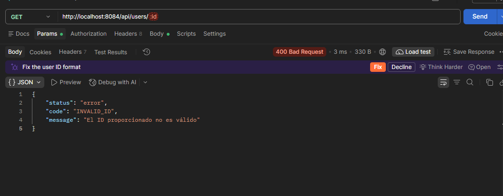

# ShipNow API

API de ShipNow con arquitectura por capas (Controller → Service → Repository), hecha con Node.js, Express y MongoDB (Mongoose).

## Instalar e Iniciar localmente la API
1. Clonamos el repositorio, desde la página, para luego abrir una terminal en la carpeta donde quede el archivo.
2. Lo instalamos, lo hacemos con las siguiente línea:
```bash
npm install
```
3. Una vez que ya esté todo instalado copiamos el archivo `.env.example` a `.env`, y completarlo con las variables solicitadas.

```
PORT=3000
MONGODB_URI=mongodb://localhost:27017/shipnow
NODE_ENV=development
```
- Para el caso de `NODE_ENV` tambien se puede poner production ya que tambien es valido.

4. Una vez que el `.env` esté completo nos podremos poner a iniciar el servidor, usando la siguiente línea:
```bash
npm run dev
```
O
```bash
npm start
```
- Si hay algún fallo de la API a la hora de iniciar se debe corroborar que todos las variables estén completas y sean auténticas y utilizables.

Necesita un MongoDB en `mongodb://localhost:27017` la cual se ingresa en el `.env`.

## Tecnologias en uso

- Node
- Express
- Faker-js
- Dotenv
- Mongoose
- MongoDB
- Winston
- winston-daily-rotate-file

## Estructura de la API

```
src/
├── config/           # carpeta donde se guardan las configuraciones de la conexión a la DB y las variables de entorno validadas
├── constants/        # aquí se guardan esas constantes que pueden ser usadas en toda la API, roles de usuarios o estados de productos
├── controllers/      # manejo de las req y las res
├── middlewares/      # manejo de errores de forma centralizada
├── models/           # los modelos de mongoose, acá no se recibe ni debe escribirse lógica del negocio
├── repositories/     # conecta la base de datos con el sistema, es el único que debe conectarse entre ambos
├── routes/           # conectan cada endpoint con su controlador
├── errors/           # errores personalizados (AppError) y diccionario de errores
└── services/         # se encarga de contener toda la lógica del negocio
```

## Logging y monitoreo

### Herramienta utilizada
Para el registro de eventos se utiliza **Winston**, el cual se encarga de registrar los eventos, en conjunto con **winston-daily-rotate-file** que realiza el trabajo de guardar en archivo los errores que se generan en nuestra API, organizandolo por fecha de creacion. Toda la configuracion de esta herramienta se centralizó en `src/config/logger.js` para no necesitar reescribir el mismo codigo y directamente importar el sistema a donde necesitemos. 

Lo que busca esto es reemplazar los `console.log` sueltos permitiendo clasificar por nivel de importancia y darles un formato común (fecha, nivel y mensaje), centralizando el tipo y la manera que tiene para guardar logs nuestra API, guardando estos en archivo con fecha y hora exacta del mismo para proceder a su posterior consulta. Lo que propone el logger es complementar el manejo de errores, sin modificar las respuestas a los clientes, y registrar los errores internos para poder ser solucionados.

### Niveles de log

| Nivel | Prioridad | Para qué se usa en ShipNow |
|---|---|---|
| `fatal` | 0 | Fallas críticas, por ejemplo no poder conectar con MongoDB al iniciar |
| `error` | 1 | Errores inesperados del servidor, con su stack |
| `warning` | 2 | Errores esperados o del cliente: ID inválido, ruta inexistente, cantidad inválida |
| `info` | 3 | Eventos normales: servidor iniciado, conexión a MongoDB, datos mock generados |
| `http` | 4 | Registro de peticiones HTTP |
| `debug` | 5 | Información de desarrollo, solo visible en `development` |

Un nivel registra también todos los de número menor: con `info` se ven `fatal`, `error`, `warning` e `info`. En los archivos de log solo se guardan `error` y `fatal`.

### Como probar el logger
Se dejó creado un endpoint de prueba que genera un log de cada nivel. No es una funcionalidad del negocio, solo sirve para verificar la configuración:

| Método | Ruta | Descripción |
|---|---|---|
| GET | /api/logger-test | Genera logs de los 6 niveles |

1. Iniciar el servidor con `npm run dev`.
2. Abrir `http://localhost:PUERTO/api/logger-test` (donde el `PUERTO` es el que quedó definido en el `.env`).
3. Revisar la terminal: aparecen los niveles correspondientes al entorno.
4. Revisar `logs/error-AAAA-MM-DD.log`: deben estar solo los niveles `error` y `fatal`.

### Guardado de logs
Los errores de tipo `error` y `fatal` son los unicos que se guardan y lo hacen en la carpeta `logs/`, en un archivo por día con el nombre `error-AAAA-MM-DD.log`. Cada línea tiene fecha, nivel y mensaje.
Para que los archivos no crezcan sin control se aplica una rotación:

- Se crea un archivo nuevo cada día.
- Si un archivo supera los 5 MB, se rota.
- Se conservan 14 días de historial.
- Los archivos viejos se comprimen.

### Archivos ignorados por el Git

Los logs generados por esta aplicacion no se pueden subir a algun repositorio, ya que en el `.gitignore` son ignorados tanto la carpeta `logs/` como los archivos `*.log`.

### Comportamiento segun el entorno

El nivel mínimo del logger depende de la variable `NODE_ENV` del `.env`:

| `NODE_ENV` | Niveles que se muestran en consola |
|---|---|
| `development` | `debug`, `http`, `info`, `warning`, `error` y `fatal` |
| `production` | `info`, `warning`, `error` y `fatal` |

En ambos entornos, el archivo de logs guarda solo `error` y `fatal`.

**(Las evidencias de uso se encontraran detalladas en la seccion de evidencias)**

## Endpoints

| Método | Ruta | Descripción |
|---|---|---|
| POST | /api/products | Crear producto |
| GET | /api/products | Listar productos disponibles |
| GET | /api/products/:id | Obtener un producto |
| PATCH | /api/products/:id | Actualizar parcialmente |
| DELETE | /api/products/:id | Eliminar |
| POST / GET / PATCH / DELETE | /api/users | Mismo esquema para usuarios |
| GET | /api/mocks/users?qty=N | Simulacion de creacion de usuarios |
| POST | /api/mocks/seed?qty=N | Inserccion de Usuarios, Pedidos y envios a la BBDD (todos son datos no reales) |
| GET | /api/logger-test | Genera logs de los 6 niveles (solo para pruebas) |

## Separación y reestructuración de la API.
Antes de comenzar con este proyecto nos encontrábamos con una API con pocos archivos y cada uno tenía miles tareas para ejecutar. Por lo que se decidió realizarle una limpieza y una reestructuración.
- **Repository**, este es el que se encarga de conectar y conocer a Mongoose, se ocupa de buscar y guardar en la misma. Es muy útil si se quiere cambiar de base de datos, ya que no precisa configuración extra.
- **Service**, es el que se ocupa de poseer y exportar las reglas del negocio, calcula el status de los productos, los stocks, rechaza mails duplicados, y no sabe nada de la base de datos.
- **Controller**, este se encarga de contener el manejo de las request y de las response de toda la API.

### Porque se realiza la separacion de la API.

- **Calcular el `status` según el `stock`** va en el Service: es una regla del negocio y no depende de cómo se guardan los datos.
- **Excluir el campo `__v` y ordenar por fecha** va en el Repository: es una decisión de acceso a datos.
- **Rechazar un email duplicado** va en el Service, que decide qué hacer. El Repository solo ofrece `getByEmail` para buscarlo.
- **Responder `404` o `409`** lo decide el middleware de errores; el Service solo lanza el error.
- **El Controller no importa Mongoose**: solo recibe la request, llama al Service y devuelve la response.

Si cambia la base de datos, se modifica el Repository. Si cambia una regla del negocio, se modifica el Service.

## Mocks.
Los Mocks que usaremos en esta API nos dan detalle de la generacion de usuarios, tanto clientes como repartidores, cantidad de pedidos y repartos. En forma de simulacion para poder verificar que todos los controladroes esten realizando de la mejor manera su trabajo. 

### Endpoints.
Los endPoints que se usaran son:
- GET /api/mocks/users?qty=N : El cual devuelve los usuarios simulados sin que estos queden guardados en nuestra Base de Datos. Cabe aclarar que N, es un numero entero, y es la cantidad de usuarios simulados que vayamos a crear. En el caso que no se agrege algun numero queda de manera predeterminada el numero 10, ademas tiene un limite de hasta 100 usuarios, por cada simulacion.
- POST /api/mocks/seed?qty=N : El cual genera e inserta usuarios, pedidos y envios a nuestra Base de Datos, todos son datos simulados, lo que significa que estos si son guardados de manera permanente en ella, por lo que cada vez que se ejecute la simulacion no se borraran las anteriores. Cabe aclarar que N, es un numero entero, y es la cantidad de datos que se generaran, ademas este numero hara que se generen esa misma cantidad de usuarios, pedidos y envios. En el caso que no se agrege algun numero queda de manera predeterminada el numero 10, ademas tiene un limite de hasta 100 usuarios, por cada simulacion.

### Relaciones.
Para comprender mejor la union de cada cosa hay que relacionar que cada pedido ingresado corresponde a un solo usuario, y cada uno de estos pedidos le corresponde un envio que queda a cargo de un solo repartidor, el cual es un usuario con otra responsabilidad (courier). En el caso que no salga ninguno de estos ultimos el envio quedara sin un repartidor asignado.

## Manejo de errores.
Para poder centralizar las respuestas y codigos de errores se realiza una integracion de todos estos en un solo lugar, lo que beneficia a la busqueda de errores. Por ejemplo si tenemos un error de HTTP: 404 y la API nos brinda un 500, el primer lugar donde debemos buscar es el este archivo (` \src\errors\error.dictionary.js `). A su vez a la hora de realizar una nueva integracion que pueda contener respuestas a errores no hay que escribirlos a mano.
Para comprender el flujo que esto presenta es sencillo dar a entender que el service detecta el error y lanza un AppError, el controller lo pasa con next(error) y el middleware es el único que responde.

Todos los errores salen del middleware global y tienen la misma estructura:
```json
{ "status": "error", "code": "USER_NOT_FOUND", "message": "Usuario no encontrado" }
```
- `status`: siempre `"error"`.
- `code`: identifica el error (primera columna de la tabla).
- `message`: mensaje para el cliente.

Las reespuestas que encontraremos en esta seccion son:

| Código | Estado HTTP | Respuesta | Descripción |
|---|---|---|---|
| `USER_NOT_FOUND` | 404 | Usuario no encontrado | No existe un usuario con el ID indicado (consulta, actualización o eliminación). |
| `USER_ALREADY_EXISTS` | 409 | El usuario ya existe | Se intenta crear un usuario con un email que ya está registrado. |
| `EMAIL_REQUIRED` | 400 | El correo electrónico es obligatorio | Se intenta crear un usuario sin enviar el email. |
| `EMAIL_ALREADY_EXISTS` | 409 | El correo electrónico ya existe | Se intenta actualizar un usuario con un email que ya usa otro usuario. |
| `VALIDATION_ERROR` | 400 | Los datos proporcionados no son válidos | Los datos enviados no cumplen las reglas del modelo (campos obligatorios, valores permitidos). |
| `PRODUCT_NOT_FOUND` | 404 | Producto no encontrado | No existe un producto con el ID indicado (consulta, actualización o eliminación). |
| `PRODUCT_ALREADY_EXISTS` | 409 | El producto ya existe | Se intenta crear un producto con un nombre que ya existe. |
| `ORDER_NOT_FOUND` | 404 | Orden no encontrada | No existe un pedido con el ID indicado. Reservado para futuros endpoints de pedidos; actualmente no se utiliza. |
| `INVALID_STATUS` | 400 | Estado inválido | El estado enviado no es uno de los permitidos. Reservado para futuras validaciones de estado; actualmente no se utiliza. |
| `INVALID_ID` | 400 | El ID proporcionado no es válido | El ID de la URL no tiene un formato válido de la Base de Datos. |
| `INVALID_QTY` | 400 | La cantidad debe ser un numero entero entre el 1 y el 100 | En los mocks, `qty` es negativa, cero, decimal, texto o mayor que 100. |
| `SEED_FAILED` | 500 | Error al cargar los datos de prueba del sistema en la base de datos | Falló la inserción de los datos simulados en la Base de Datos. |
| `INTERNAL_SERVER_ERROR` | 500 | Error interno del servidor | Error inesperado que no corresponde a ningún caso anterior. |

### Comprobaciones de los casos inválidos
Todas las pruebas se deben hacer con el servidor corriendo y desde Postman o programa similar. En cada caso, la respuesta tiene que tener la estructura de error que describimos mas arriba.

| Caso | Request | Estado HTTP | Código | Cómo comprobarlo |
|---|---|---|---|---|
| Cantidad negativa | `GET /api/mocks/users?qty=-5` | 400 | `INVALID_QTY` | Enviar `qty` con un número negativo. |
| Cantidad igual a cero | `POST /api/mocks/seed?qty=0` | 400 | `INVALID_QTY` | Enviar `qty=0`. |
| Cantidad decimal | `GET /api/mocks/users?qty=2.5` | 400 | `INVALID_QTY` | Enviar `qty` con un número con decimales. |
| Cantidad no numérica | `GET /api/mocks/users?qty=abc` | 400 | `INVALID_QTY` | Enviar `qty` con texto. |
| Cantidad mayor al máximo | `GET /api/mocks/users?qty=101` | 400 | `INVALID_QTY` | Enviar `qty` mayor a 100. |
| Falla al cargar en MongoDB | `POST /api/mocks/seed?qty=3` | 500 | `SEED_FAILED` | Detener MongoDB con el servidor ya iniciado y ejecutar el seed. |
| ID con formato inválido | `GET /api/users/123` | 400 | `INVALID_ID` | Usar un ID que no tenga formato de MongoDB. |
| Usuario inexistente | `GET /api/users/<id válido>` | 404 | `USER_NOT_FOUND` | Usar un ID con formato correcto que no esté en la base (por ejemplo, de un usuario ya eliminado). |
| Usuario sin email | `POST /api/users` | 400 | `EMAIL_REQUIRED` | Enviar el body sin el campo `email`. |
| Usuario sin nombre | `POST /api/users` | 400 | `VALIDATION_ERROR` | Enviar el body con `email` pero sin `name`. |
| Usuario duplicado | `POST /api/users` | 409 | `USER_ALREADY_EXISTS` | Enviar dos veces el mismo `email`. |
| Email ya en uso | `PATCH /api/users/<id>` | 409 | `EMAIL_ALREADY_EXISTS` | Actualizar un usuario con el `email` de otro. |
| Producto inexistente | `GET /api/products/<id válido>` | 404 | `PRODUCT_NOT_FOUND` | Usar un ID con formato correcto que no esté en la base. |
| Producto duplicado | `POST /api/products` | 409 | `PRODUCT_ALREADY_EXISTS` | Crear dos productos con el mismo `name`. |

## Evidencias de Uso.
### A continuacion se veran, en formato de imagenes, las evidencias de como se verian el uso de las RUTAS mediante el uso del programa de POSTMAN.

#### Endpoints GET

- GET /api/users


- GET /api/products


- GET /api/products/id


- GET /api/mocks/users


#### Endpoints POST

- POST /api/users


- POST /api/products


- POST /api/mocks/seed


#### Endpoints PATCH

- PATCH /api/products/:id


- PATCH /api/users/:id


#### Endpoints DELETE

- DELETE /api/users/:id


- DELETE /api/products/:id


## Evidencias de Uso de errores.
### A continuacion se veran, en formato de imagenes, las evidencias de como se verian los errores que pueden dejar los endpoints teniendo en cuenta el uso del programa de POSTMAN.

- GET /api/mocks/users con numero entero negativo


- GET /api/users/:id  con ID inválido


- POST /api/mocks/seed sin conexión a la base de datos


## Evidencias de logs
### A continuacion se veran, en formato de imagenes, las evidencias de cómo se registran los logs según la variable **NODE_ENV**, detalles de los mismos.

**development**
- GET /api/logger-test


**production**
- GET /api/logger-test


**Carpeta de logs**
- Visualizacion de carpeta de logs


**Archivo log**
- Visualizacion de un archivo .log
